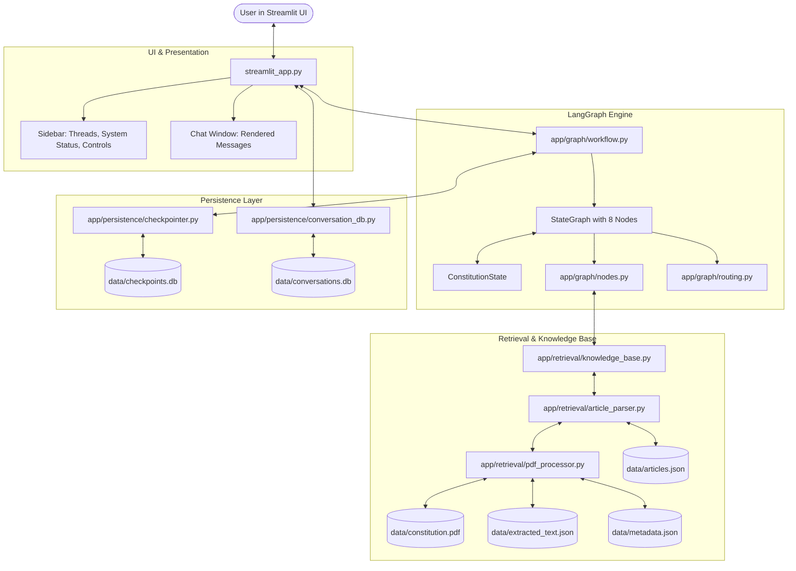
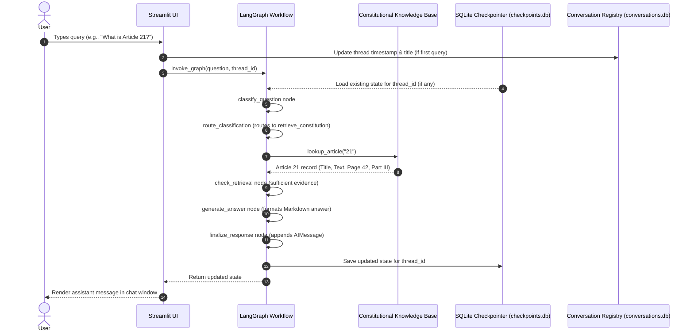

# System Architecture — ConstitutionGPT

ConstitutionGPT is a deterministic legal question-answering assistant for the Constitution of India. It operates entirely locally with **zero generative AI, zero LLMs, zero embedding models, and zero external API dependencies**.

---

## 1. Architectural Principles

1. **Deterministic Grounding:** All responses are derived strictly from the official Constitution of India PDF (`95ef471035ee0b5e4e5b1cac3d3584c1.pdf`). If an answer is not present or verified, the system honestly reports uncertainty rather than hallucinating.
2. **State Machine Reasoning (LangGraph):** The conversational logic is structured as an explicit directed state graph with deterministic nodes and conditional routing functions.
3. **Dual Persistence Layers:**
   - **LangGraph Checkpointer (`checkpoints.db`):** Low-level state snapshotting across turns and restarts.
   - **Conversation Registry (`conversations.db`):** High-level thread metadata (titles, timestamps) for UI navigation.
4. **Zero-Latency In-Memory Ingestion:** Ingestion runs once, writing structured JSON caches (`extracted_text.json` and `articles.json`). Subsequent queries execute in sub-millisecond in-memory lookups.

---

## 2. Component Architecture



---

## 3. Directory Layout

```text
lawchatbot/
├── streamlit_app.py             # Streamlit application entry point
├── requirements.txt             # Clean dependencies
├── README.md                    # Setup and usage guide
├── .gitignore                   # Git ignore rules
├── config/
│   ├── __init__.py
│   └── settings.py              # Path configurations and constants
├── app/
│   ├── __init__.py
│   ├── graph/
│   │   ├── __init__.py
│   │   ├── state.py             # ConstitutionState TypedDict
│   │   ├── nodes.py             # 8 deterministic graph nodes
│   │   ├── routing.py           # Conditional routing functions
│   │   └── workflow.py          # StateGraph assembly & compilation
│   ├── retrieval/
│   │   ├── __init__.py
│   │   ├── pdf_processor.py     # PDF validation, hash, and text extraction
│   │   ├── article_parser.py    # Article parsing & landmark repositories
│   │   └── knowledge_base.py    # Search, normalization, and scoring
│   └── persistence/
│       ├── __init__.py
│       ├── checkpointer.py      # SQLite checkpointer (SqliteSaver)
│       └── conversation_db.py   # Conversation registry database
├── data/
│   ├── constitution.pdf         # Local copy of the verified PDF
│   ├── extracted_text.json      # Page-by-page text cache (402 pages)
│   ├── articles.json            # Parsed articles & constitutional text
│   ├── metadata.json            # Hash, page counts, and extraction stats
│   ├── checkpoints.db           # Persistent LangGraph state checkpoints
│   └── conversations.db         # Conversation registry for sidebar
├── tests/
│   ├── __init__.py
│   ├── test_pdf_processor.py    # Ingestion, validation, OCR tests
│   ├── test_retrieval.py        # Normalization, scoring, lookup tests
│   ├── test_graph.py            # Node, routing, and accumulation tests
│   ├── test_checkpointer.py     # Persistence & thread isolation tests
│   ├── test_conversations.py    # Conversation CRUD tests
│   └── test_master_examples.py  # 10 canonical user queries test
└── docs/
    ├── LANGGRAPH_GUIDE.md       # Beginner guide to LangGraph in this app
    └── ARCHITECTURE.md          # This architecture document
```

---

## 4. Data Flow Walkthrough



---

## 5. Persistence & Thread Safety

- **SQLite Connections:** All SQLite connections use `check_same_thread=False` with connection timeouts to operate reliably across Streamlit's multi-threaded rerun model.
- **Thread Isolation:** The SQLite checkpointer partitions states by `thread_id`. Asking about Article 14 in Thread A and Article 21 in Thread B guarantees zero cross-talk.
- **Clean Deletion:** Deleting a chat thread removes the entry from `conversations.db` and invokes `checkpointer.delete_thread(thread_id)` to scrub persisted state completely.
