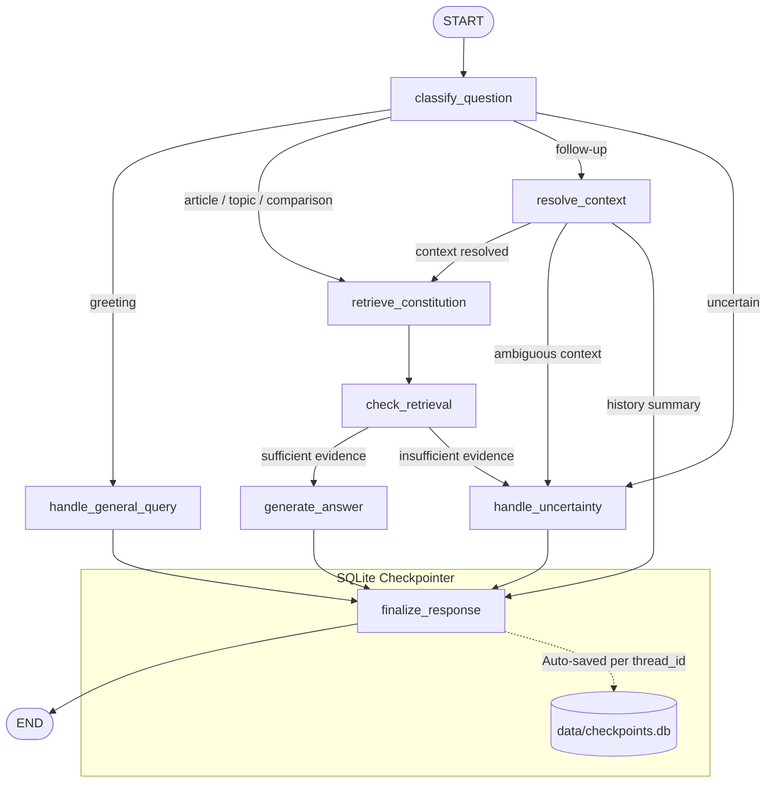

# LangGraph Guide for ConstitutionGPT

A beginner-friendly, comprehensive guide explaining how **LangGraph** concepts are implemented in this application.

ConstitutionGPT demonstrates the core mechanics of LangGraph without relying on LLMs or external AI services. Instead, it uses deterministic Python logic, rule-based classification, and SQLite checkpointing.

---

## 1. What is LangGraph?

**LangGraph** is a library for building stateful, multi-actor applications with graphs. While commonly used with Large Language Models (LLMs), LangGraph is fundamentally a **state-machine execution engine**. Any deterministic Python function can serve as a node in a LangGraph graph.

---

## 2. Core LangGraph Concepts & Code Mapping

### Concept 1: State
* **What it is:** The shared data structure passed from node to node throughout the execution of the graph. Every node receives the current state and returns a dictionary of updates to apply to the state.
* **Where it appears in code:** [`ConstitutionState`](file:///c:/Users/Lenovo/OneDrive/Desktop/lawchatbot/app/graph/state.py#L14-L40) in [`app/graph/state.py`](file:///c:/Users/Lenovo/OneDrive/Desktop/lawchatbot/app/graph/state.py).
* **Code snippet:**
  ```python
  class ConstitutionState(TypedDict, total=False):
      messages: Annotated[Sequence[BaseMessage], add_messages]
      question: str
      intent: str
      article_number: Optional[str]
      comparison_articles: Optional[List[str]]
      topic: Optional[str]
      retrieved_documents: List[Dict[str, Any]]
      comparison_data: Optional[Dict[str, Any]]
      answer: str
      sources: List[Dict[str, Any]]
      needs_clarification: bool
      response_type: str
  ```

---

### Concept 2: Message Reducer (`add_messages`)
* **What it is:** When a node returns a state update containing `messages`, LangGraph does not overwrite the existing message list by default. The `add_messages` annotation acts as a **reducer**: it appends new messages while updating existing ones if their IDs match.
* **Where it appears in code:** [`messages: Annotated[Sequence[BaseMessage], add_messages]`](file:///c:/Users/Lenovo/OneDrive/Desktop/lawchatbot/app/graph/state.py#L29) in [`app/graph/state.py`](file:///c:/Users/Lenovo/OneDrive/Desktop/lawchatbot/app/graph/state.py).
* **Why it matters:** This allows multi-turn conversations to accumulate history seamlessly without manual list concatenations in Streamlit.

---

### Concept 3: Nodes
* **What it is:** Independent Python functions that perform a single unit of work (e.g., classifying a question, looking up context, querying a database, formatting a response).
* **Where it appears in code:** [`app/graph/nodes.py`](file:///c:/Users/Lenovo/OneDrive/Desktop/lawchatbot/app/graph/nodes.py).
* **The 8 Nodes in ConstitutionGPT:**
  1. [`classify_question`](file:///c:/Users/Lenovo/OneDrive/Desktop/lawchatbot/app/graph/nodes.py#L48): Analyzes user intent (greeting, article lookup, topic query, comparison, or follow-up).
  2. [`resolve_context`](file:///c:/Users/Lenovo/OneDrive/Desktop/lawchatbot/app/graph/nodes.py#L210): Inspects prior `messages` to determine which article or topic a pronoun ("it", "the earlier article") refers to.
  3. [`retrieve_constitution`](file:///c:/Users/Lenovo/OneDrive/Desktop/lawchatbot/app/graph/nodes.py#L268): Queries the local knowledge base extracted from the Constitution PDF.
  4. [`check_retrieval`](file:///c:/Users/Lenovo/OneDrive/Desktop/lawchatbot/app/graph/nodes.py#L351): Evaluates whether retrieved evidence is sufficient to answer the prompt.
  5. [`generate_answer`](file:///c:/Users/Lenovo/OneDrive/Desktop/lawchatbot/app/graph/nodes.py#L357): Generates a grounded, formatted response with verbatim constitutional text, plain English explanations, examples, and source page citations.
  6. [`handle_general_query`](file:///c:/Users/Lenovo/OneDrive/Desktop/lawchatbot/app/graph/nodes.py#L481): Responds to greetings, help requests, and system overview inquiries.
  7. [`handle_uncertainty`](file:///c:/Users/Lenovo/OneDrive/Desktop/lawchatbot/app/graph/nodes.py#L506): Delivers an honest fallback message when evidence is missing or ambiguous.
  8. [`finalize_response`](file:///c:/Users/Lenovo/OneDrive/Desktop/lawchatbot/app/graph/nodes.py#L529): Packages the final answer into an `AIMessage` and appends it to conversation history.

---

### Concept 4: Edges & START / END
* **What it is:** Connections that determine execution transitions from one node to the next.
  - `START`: The entry point where execution begins when `.invoke()` is called.
  - `END`: The terminal point where graph execution finishes and returns the final state.
* **Where it appears in code:** [`build_constitution_graph`](file:///c:/Users/Lenovo/OneDrive/Desktop/lawchatbot/app/graph/workflow.py#L35-L87) in [`app/graph/workflow.py`](file:///c:/Users/Lenovo/OneDrive/Desktop/lawchatbot/app/graph/workflow.py).
* **Code snippet:**
  ```python
  builder.add_edge(START, "classify_question")
  builder.add_edge("retrieve_constitution", "check_retrieval")
  builder.add_edge("finalize_response", END)
  ```

---

### Concept 5: Conditional Edges & Routing Functions
* **What it is:** Branches where the next node to execute depends dynamically on the state. A router function examines the state and returns a string naming the next node.
* **Where it appears in code:** [`app/graph/routing.py`](file:///c:/Users/Lenovo/OneDrive/Desktop/lawchatbot/app/graph/routing.py).
* **The 3 Routing Functions:**
  1. [`route_classification`](file:///c:/Users/Lenovo/OneDrive/Desktop/lawchatbot/app/graph/routing.py#L10):
     - `greeting` $\rightarrow$ `handle_general_query`
     - `article_lookup` / `comparison` / `topic_lookup` $\rightarrow$ `retrieve_constitution`
     - `follow_up` $\rightarrow$ `resolve_context`
     - `uncertain` $\rightarrow$ `handle_uncertainty`
  2. [`route_context`](file:///c:/Users/Lenovo/OneDrive/Desktop/lawchatbot/app/graph/routing.py#L39):
     - If context resolved $\rightarrow$ `retrieve_constitution`
     - If ambiguous / no prior context $\rightarrow$ `handle_uncertainty`
     - If history inquiry $\rightarrow$ `finalize_response`
  3. [`route_retrieval`](file:///c:/Users/Lenovo/OneDrive/Desktop/lawchatbot/app/graph/routing.py#L55):
     - If documents/comparison found $\rightarrow$ `generate_answer`
     - If nothing found $\rightarrow$ `handle_uncertainty`

---

### Concept 6: Graph Compilation
* **What it is:** Converting the `StateGraph` definition into a runnable `CompiledStateGraph` object. This validates that all referenced nodes and edges exist and have no dangling routes.
* **Where it appears in code:** [`get_compiled_graph`](file:///c:/Users/Lenovo/OneDrive/Desktop/lawchatbot/app/graph/workflow.py#L90-L101) in [`app/graph/workflow.py`](file:///c:/Users/Lenovo/OneDrive/Desktop/lawchatbot/app/graph/workflow.py).
* **Code snippet:**
  ```python
  builder = build_constitution_graph()
  compiled_graph = builder.compile(checkpointer=saver)
  ```

---

### Concept 7: Checkpoint & Checkpointer (`SqliteSaver`)
* **What it is:** A persistence engine that serializes graph state after every superstep (node execution) into an external database (SQLite).
* **Where it appears in code:** [`app/persistence/checkpointer.py`](file:///c:/Users/Lenovo/OneDrive/Desktop/lawchatbot/app/persistence/checkpointer.py).
* **Why it matters:**
  - Even if Streamlit reruns or the Python server restarts, previous messages and state values remain safe in SQLite.
  - Calling `graph.get_state(config)` allows restoring the exact conversation history on page load.
* **Code snippet:**
  ```python
  conn = sqlite3.connect("data/checkpoints.db", check_same_thread=False)
  saver = SqliteSaver(conn)
  saver.setup()
  ```

---

### Concept 8: Threads and `thread_id`
* **What it is:** The identifier used to partition conversation state. Each conversation gets a unique UUID `thread_id`.
* **Where it appears in code:** Passed in the `config` dictionary during invocation and state queries.
* **Code snippet:**
  ```python
  config = {
      "configurable": {
          "thread_id": "c76a953e-5e26-44aa-ba42-e9cb96412bcf"
      }
  }
  result = graph.invoke(input_state, config=config)
  ```
* **Thread Isolation:** Thread A discussing Article 14 and Thread B discussing Article 21 never overwrite or leak into each other's state.

---

## 3. End-to-End Workflow Diagram



---

## 4. How a Query Traverses the Graph

1. **User asks:** *"What is Article 21?"*
2. **`START` $\rightarrow$ `classify_question`:**
   - Detects article lookup for `21`.
   - Returns `intent="article_lookup"`, `article_number="21"`.
3. **`route_classification` $\rightarrow$ `retrieve_constitution`:**
   - Normalizes `"21"`, searches `data/articles.json`.
   - Finds *Article 21: Protection of life and personal liberty* (Page 42 of PDF).
   - Returns `retrieved_documents=[doc]`, `sources=[{page: 42, article: 21}]`.
4. **`check_retrieval` $\rightarrow$ `route_retrieval` $\rightarrow$ `generate_answer`:**
   - Formats Markdown block: constitutional text, plain English summary, principles, examples, source citation.
5. **`finalize_response` $\rightarrow$ `END`:**
   - Wraps text in `AIMessage`, appends to `messages`.
   - Checkpointer writes state to `data/checkpoints.db`.
6. **Follow-up:** *"Explain it simply."*
   - Next turn in same `thread_id`.
   - `classify_question` returns `intent="follow_up_simple"`.
   - `resolve_context` reads previous `messages`, extracts `Article 21`.
   - Routes to `retrieve_constitution` for `Article 21`.
   - `generate_answer` provides simple English explanation.
   - History advances to 4 messages.
